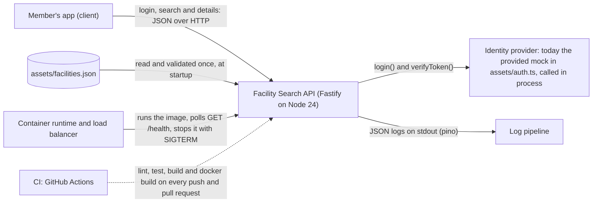
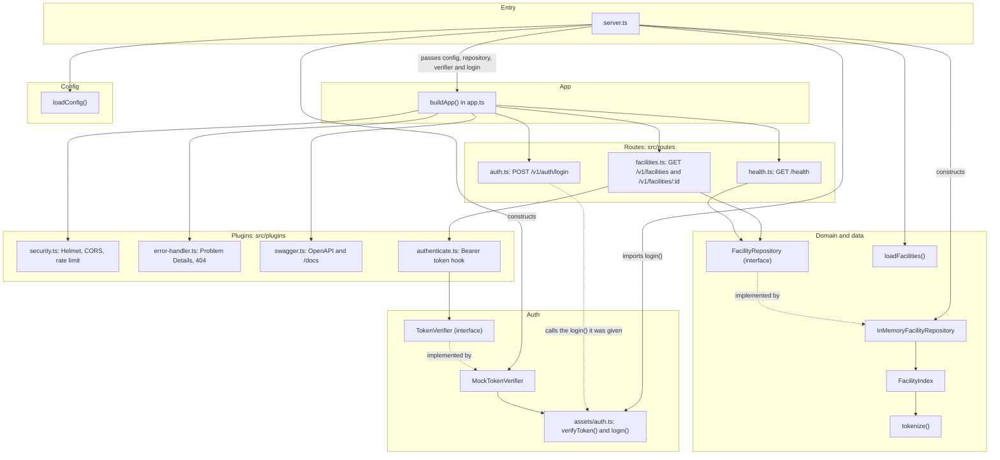
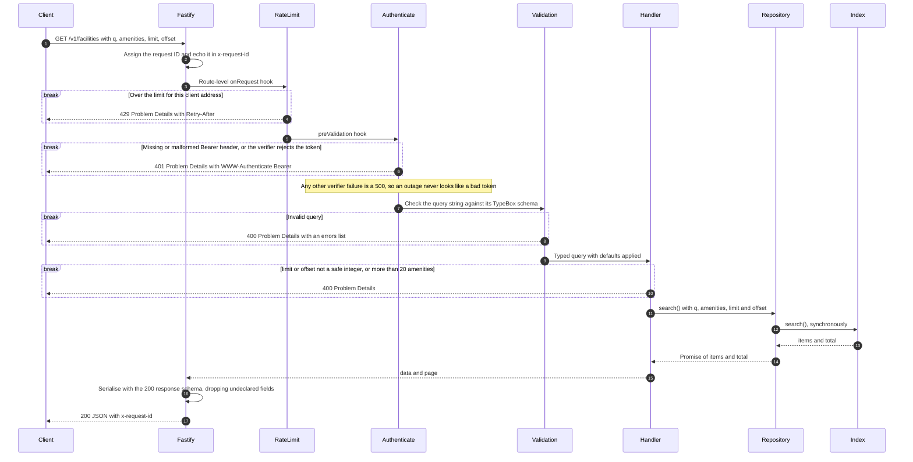
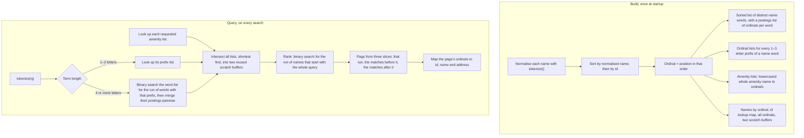
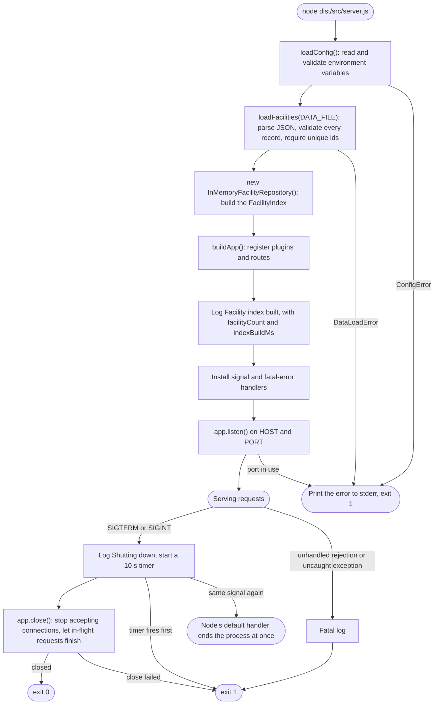
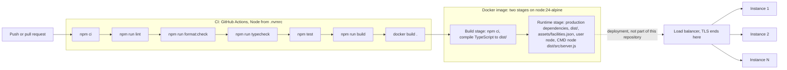

# Facility Search API — Architecture

This guide is for developers new to the codebase: it shows how the parts of the Facility Search API fit together and how to change them safely. It explains how the code works; the reasons behind each decision are in [`DESIGN.md`](DESIGN.md).

**Read next:** [`DESIGN.md`](DESIGN.md) for why it is built this way, [`TESTING.md`](TESTING.md) for how it is tested, and the [`README`](../README.md) for the quick start and the API.

**Interactive diagrams.** Two standalone HTML pages show the same system with dark and light themes. Click any box to see the source lines behind it. GitHub shows `.html` files as source code, so download them or open them from a local clone in a browser.

- [`diagrams/architecture-overview.html`](diagrams/architecture-overview.html): every component, the main request path, token checks, error exits and startup.
- [`diagrams/search-request-flow.html`](diagrams/search-request-flow.html): one `GET /v1/facilities` request, step by step, with its 429, 401 and 400 exits.

## System context



- **Identity provider.** Today it is a module the API imports, not a network service: `login()` waits 0.5–2 s and `verifyToken()` waits 100–500 ms to imitate one. A real provider replaces it behind the `TokenVerifier` interface (see [Plug in a real JWT verifier](#plug-in-a-real-jwt-verifier)).
- **Data.** The JSON file is the only data source. Each instance loads all of it into memory at startup, so a data change needs a restart.
- **Operators** see JSON logs on stdout, poll `GET /health` (never rate limited, never request-logged) and stop the process with SIGTERM.

## Layers and components



Not drawn, because several layers share them: `src/schemas/` (TypeBox schemas), `src/domain/facility.ts` (types and the facility id rule) and `src/errors/http-error.ts`.

**The dependency rule:** each layer depends only on the layers below it. The index knows nothing about HTTP, and routes see only the `FacilityRepository` and `TokenVerifier` interfaces, never the classes behind them. `server.ts` is the only file in `src/` that constructs the implementations behind those interfaces (`InMemoryFacilityRepository` and `MockTokenVerifier`); `buildApp` receives everything as arguments. That is why tests can pass fakes to `buildApp`, and why a database or a real JWT verifier can replace the in-memory store or the mock without route changes. See [`DESIGN.md` §4](DESIGN.md#4-architecture).

## A search request, step by step

`GET /v1/facilities`, from arrival to response. Each `break` is an early exit. For an interactive version that links each step to its source lines, see [`diagrams/search-request-flow.html`](diagrams/search-request-flow.html).



1. **Request ID.** Fastify calls `requestIdFor` (the `genReqId` option in `app.ts`) as the request arrives. A well-formed incoming `x-request-id` (`^[A-Za-z0-9._-]{1,128}$`) is reused; anything else is replaced with a UUID. The first app-level `onRequest` hook echoes it in the response header, and every log line for the request carries it as `requestId`.
2. **App-level `onRequest` hooks** run in registration order: that echo, then Helmet's security headers, then CORS when `CORS_ORIGINS` is set. CORS answers preflight requests itself, so they stop here and are never counted by the limiter.
3. **Rate limit.** `@fastify/rate-limit` attaches its `onRequest` hook to each route, and Fastify runs route-level hooks after app-level ones. Over the limit, it throws a 429.
4. **Authentication** is a `preValidation` hook (`createAuthenticate(tokenVerifier)`) added once inside the facility route plugin, so it covers every route in that plugin and no other. `preValidation` runs after the limiter, so a flood never reaches the slow verifier, and before validation, so a caller without a token learns nothing about valid parameters. An `onRequest` auth hook would run before the route-level limiter. Tests guard both sides of this order; the reasoning is in [`DESIGN.md` §6](DESIGN.md#6-request-lifecycle) and [§4.1](DESIGN.md#41-boundaries).
5. **Validation.** Fastify checks the query string against `SearchFacilitiesQuerySchema`, converting `limit` and `offset` to integers and filling in their defaults (20 and 0).
6. **Handler.** Validation turns a value such as `limit=1e400` into `Infinity` and skips its range check, so the handler rejects any `limit` or `offset` that is not a safe integer. It splits `amenities` on commas (more than 20 non-empty entries is a 400) and calls `repository.search`.
7. **Serialisation** uses the route's 200 response schema, which drops any field the schema doesn't declare, so internal fields can't leak.
8. **Errors** from any step reach the one error handler in `src/plugins/error-handler.ts`, which sends RFC 9457 Problem Details with the `requestId`. Validation errors become a 400 with an `errors` list, 4xx errors keep their status and message, and anything else becomes a generic 500 with the details in the log only.

A request that Fastify's router rejects outright (a malformed URL, or a path parameter over 100 characters) never reaches these hooks. The `frameworkErrors` option in `app.ts` answers it with a 400 Problem Details response that carries the request ID, but without rate limiting or security headers.

## Inside the search index

`FacilityIndex` (`src/search/facility-index.ts`) is built once from the loaded facilities and never changes. Internally, each facility is identified by its **ordinal**, its position in name order, and every list of ordinals is kept in ascending order. Any list of matches is therefore already alphabetical, so no request sorts facilities by name.



- With no `q` and no `amenities`, the matches are all ordinals in name order, and nothing is ranked. With `amenities` alone, nothing is ranked either.
- A `q` made only of punctuation (for example `&&`) returns an empty page with a total of 0, not every facility.
- An unknown amenity has an empty list, so it matches nothing. Repeated terms and amenities count once.
- `total` is the number of matches across all pages.

**`search()` must stay synchronous.** Intersections write into two scratch buffers that belong to the index, and the match list can be a view of one of them until `search()` returns; the page is copied out before then. If `search()` ever awaited something mid-way, another request could overwrite those buffers. `InMemoryFacilityRepository` calls `search()` synchronously and wraps the finished result in `Promise.resolve`, so the async `FacilityRepository` interface doesn't break this rule.

Why the index is shaped like this, including the earlier versions that failed at 1,000,000 facilities: [`DESIGN.md` §5](DESIGN.md#5-search-index). Build time, memory and query timings: the README's [Performance](../README.md#performance) section.

## Startup and shutdown



- **Startup failures** at any step, not only those drawn, go to the `main().catch` in `server.ts`. It prints the error with `console.error` (a plain stack trace on stderr, not a JSON log line) and exits with code 1 before the port opens. The message names the problem, for example `ConfigError: Invalid configuration: PORT must be integer` or `DataLoadError: Invalid facility at index 0: /id must match pattern "^[A-Za-z0-9_-]+$"`. The service never starts with partial data.
- **Shutdown.** While closing, Fastify answers new requests on open connections with its own 503. A different signal during shutdown (SIGINT after SIGTERM) is ignored. The listeners are registered with `process.once`, so repeating the same signal, such as a second Ctrl+C, reaches Node's default handler.
- **Fatal errors.** Unhandled rejections and uncaught exceptions are logged at fatal level and exit with code 1, so the supervisor restarts the service from a clean state.

Reasoning: [`DESIGN.md` §8.6](DESIGN.md#86-shutdown).

## Build and deploy



- **CI** (`.github/workflows/ci.yml`) runs on every push and pull request with read-only repository permissions. It builds the image only to prove that it builds; it doesn't push it anywhere or deploy it. The right-hand side of the diagram is the intended production shape, not something this repository sets up.
- **The image** sets `NODE_ENV=production`, `HOST=0.0.0.0` and `PORT=3000`, runs as the non-root `node` user, and starts `node` directly rather than through npm, so `docker stop`'s SIGTERM reaches the app and shutdown is clean.
- **`TRUST_PROXY`** must list the load balancers' addresses or CIDR ranges. The rate limiter then uses the client address they add to `X-Forwarded-For` and trusts nothing else in that header. Left empty behind a proxying load balancer, every client appears to come from the load balancer, so they all share one limit.
- **Rate limits are per instance**, because counts live in each instance's memory. Shared limits need a Redis store, which is not built ([`DESIGN.md` §13](DESIGN.md#13-scaling-path-and-future-work)).
- **Each instance** loads the data file and builds its own index at startup.

## Module map

| File                                      | Responsibility                                                                                                                                                                        | Depends on                                                                                                                                      |
| ----------------------------------------- | ------------------------------------------------------------------------------------------------------------------------------------------------------------------------------------- | ----------------------------------------------------------------------------------------------------------------------------------------------- |
| `src/server.ts`                           | Entry point: loads config and data, builds the index and the app, listens; handles SIGTERM, SIGINT and fatal errors                                                                   | `config`, `data/load-facilities`, `repositories/facility-repository`, `auth/token-verifier`, `app`, `assets/auth.ts`                            |
| `src/app.ts`                              | `buildApp(deps)`: creates Fastify (logger with redaction, `trustProxy`, 10 KB body limit, request IDs, router errors) and registers the plugins and routes; exports `AppDependencies` | `config` (type), `plugins/security`, `plugins/error-handler`, `plugins/swagger`, `routes/*`, the `FacilityRepository` and `TokenVerifier` types |
| `src/config.ts`                           | `loadConfig()`: validates environment variables with TypeBox, applies defaults, splits lists, checks `TRUST_PROXY` entries; `Config`, `ConfigError`                                   | `typebox`, `node:net`                                                                                                                           |
| `src/domain/facility.ts`                  | Types `Facility`, `FacilitySummary`, `FacilitySearch`, `FacilitySearchResult`; the id rule (`FACILITY_ID_PATTERN`, `FACILITY_ID_MAX_LENGTH` = 64)                                     | Nothing                                                                                                                                         |
| `src/data/load-facilities.ts`             | `loadFacilities()` and `parseFacilities()`: read the JSON file, validate each record, reject duplicate ids, rename `facilities` to `amenities`; `DataLoadError`                       | `domain/facility`, `typebox`                                                                                                                    |
| `src/search/tokenize.ts`                  | `tokenize()`: Unicode NFKD, strip accents, lowercase, split on anything that isn't a letter or digit                                                                                  | Nothing                                                                                                                                         |
| `src/search/facility-index.ts`            | `FacilityIndex`: builds the in-memory index; `search()`, `findById()`, `size`                                                                                                         | `search/tokenize`, `domain/facility`                                                                                                            |
| `src/repositories/facility-repository.ts` | `FacilityRepository` interface (async `search`, `findById`, `count`) and `InMemoryFacilityRepository`, which wraps `FacilityIndex`                                                    | `search/facility-index`, `domain/facility`                                                                                                      |
| `src/auth/token-verifier.ts`              | `TokenVerifier` interface; `MockTokenVerifier`, which checks the user's shape and the expiry the mock ignores; `InvalidTokenError`; `AuthenticatedUserSchema`                         | `assets/auth.ts` (`verifyToken`), `typebox`                                                                                                     |
| `src/errors/http-error.ts`                | `HttpError(statusCode, message)`: an expected failure whose message is safe to show clients                                                                                           | Nothing                                                                                                                                         |
| `src/plugins/security.ts`                 | `registerSecurity()`: Helmet, CORS when `CORS_ORIGINS` is set, and the global rate limit                                                                                              | `config` (type), `@fastify/helmet`, `@fastify/cors`, `@fastify/rate-limit`                                                                      |
| `src/plugins/error-handler.ts`            | `sendProblem()`; `registerErrorHandler()`: the error handler and the rate-limited 404 handler. Must be registered after `registerSecurity`, because it uses `app.rateLimit()`         | `node:http` (status titles), Fastify types                                                                                                      |
| `src/plugins/swagger.ts`                  | `registerSwagger()`: OpenAPI 3.1 document generated from the route schemas; Swagger UI at `/docs`                                                                                     | `@fastify/swagger`, `@fastify/swagger-ui`                                                                                                       |
| `src/plugins/authenticate.ts`             | `createAuthenticate(verifier)`: the Bearer-token hook; sets `request.user`; 401 with `WWW-Authenticate: Bearer`                                                                       | `auth/token-verifier`, `errors/http-error`                                                                                                      |
| `src/routes/health.ts`                    | `GET /health`, exempt from rate limiting                                                                                                                                              | `FacilityRepository` (type), `typebox`                                                                                                          |
| `src/routes/auth.ts`                      | `POST /v1/auth/login` with its own limit of 10 a minute; the `LoginFn` type; maps the mock's "Invalid credentials" to a 401                                                           | `schemas/auth`, `schemas/problem`, `errors/http-error`, `AuthenticatedUser` (type)                                                              |
| `src/routes/facilities.ts`                | `GET /v1/facilities` and `GET /v1/facilities/:id`; the auth hook at `preValidation`; the safe-integer and amenity-count checks                                                        | `plugins/authenticate`, `schemas/facilities`, `schemas/problem`, `errors/http-error`, the two interfaces (types)                                |
| `src/schemas/auth.ts`                     | Login body (email format, at most 254 characters; password 1–128 characters) and response schemas                                                                                     | `auth/token-verifier` (`AuthenticatedUserSchema`), `typebox`                                                                                    |
| `src/schemas/facilities.ts`               | Search query, id parameter, summary, detail and search response schemas; `MAX_AMENITY_FILTERS` = 20, `DEFAULT_LIMIT` = 20                                                             | `domain/facility`, `typebox`                                                                                                                    |
| `src/schemas/problem.ts`                  | `ProblemSchema` (RFC 9457) and `ProblemResponse`, which documents errors as `application/problem+json`                                                                                | `typebox`                                                                                                                                       |
| `assets/auth.ts`                          | Provided mock, never modified: `login()` (0.5–2 s; the password `error` fails) and `verifyToken()` (100–500 ms; decodes an unsigned token)                                            | Nothing                                                                                                                                         |

## Conventions

- **ESM.** The package is `"type": "module"` and compiles with `NodeNext` resolution, so relative imports end in `.js` even in `.ts` files: `import { buildApp } from './app.js'`.
- **TypeBox comes from `typebox`** (version 1.x), not `@sinclair/typebox`. Standalone validators use `Compile` from `typebox/compile` (see `config.ts`, `load-facilities.ts`, `token-verifier.ts`).
- **One schema per route input and response.** It drives validation, the handler's types (through `@fastify/type-provider-typebox`), the OpenAPI document and response serialisation, which drops undeclared fields. Query parameters with defaults are `Type.Optional`, so the OpenAPI document doesn't mark them required.
- **Errors.** Expected failures throw `HttpError(status, message)`; the message goes to the client, so it must be safe to show. Everything thrown ends up in the one error handler, which produces Problem Details. Document every error status a route can return with `ProblemResponse`, so the OpenAPI document shows `application/problem+json`.
- **Route plugins** are `FastifyPluginCallbackTypebox` functions in the callback style: they register their routes synchronously and end with `done()`. They receive their dependencies as plugin options, and hooks they add apply only to their own routes.
- **Dependencies are passed into `buildApp`** (`config`, `repository`, `tokenVerifier`, `login`). Only `server.ts` creates the real ones, and nothing stateful lives at module level, so each test can build its own isolated app.
- **Nothing secret in logs.** Use `request.log` or `app.log`. The `Authorization` header is redacted and request bodies are never logged; never log a token or a password yourself. Token rejection reasons are logged at debug level only.
- **Formatting and linting.** Prettier (single quotes, print width 100) and ESLint with typescript-eslint's type-checked rules. CI fails on either.

## How-tos

### Add an endpoint

1. **Schema.** Add TypeBox schemas for the inputs and the success response in `src/schemas/`.
2. **Route plugin.** Add a callback-style plugin in `src/routes/`, modelled on `health.ts` (public) or `facilities.ts` (protected). Give each route `tags`, a `summary`, its input schemas and a `response` map with the success schema plus `ProblemResponse` for each error status. Throw `HttpError` for expected failures, and end the plugin with `done()`. A protected route needs `createAuthenticate(tokenVerifier)` as a `preValidation` hook in its plugin, the way `facilities.ts` adds it, and `security: [{ bearerAuth: [] }]` in its schema so Swagger UI sends the token.
3. **Register it** in `buildApp` (`src/app.ts`) with `await app.register(yourRoutes, { prefix: '/v1', ...dependencies })`, after `registerSecurity`: the rate limiter attaches itself only to routes added after it. A new dependency goes into `AppDependencies`, with the real one created in `server.ts` and a test one in `buildTestApp()` (`test/test-app.ts`).
4. **Test it** in `test/integration/` with `buildTestApp()` and `app.inject()`: the success case, each error as Problem Details, a 401 without a token for protected routes, and the route's entry in `/docs/json`. See [`TESTING.md`](TESTING.md).
5. **Document it** in the README's API table.

### Replace the in-memory store with a database

1. **Implement `FacilityRepository`** in `src/repositories/`: `search({ q, amenities, limit, offset })` returns `{ items, total }` with summaries only, `findById(id)` returns a `Facility` or `undefined`, and `count()` returns the number of facilities. `/health` calls `count()` on every poll, so keep it cheap.
2. **Keep the search rules:** every typed word must match the start of a word in the name, after the same normalisation as `tokenize()`; amenities match whole names, ignoring case, and a facility must have all of them; names that start with the whole query come first, and each group is ordered by normalised name, then id, in plain code-unit order rather than a locale's collation; `total` counts matches across all pages. The tests in `test/unit/facility-index.test.ts`, including the brute-force reference test, define these rules.
3. **Construct it in `server.ts`** in place of `InMemoryFacilityRepository`, and drop `loadFacilities` if the database becomes the source. Connection settings belong in `config.ts`. Closing the connection pool in an `onClose` hook keeps shutdown clean, because `app.close()` runs those hooks.
4. **Leave the routes alone.** They depend only on the interface. Integration tests can keep the in-memory repository, or pass the new one through `buildTestApp({ repository })`.
5. **Switch to cursor pagination** once data can change between page requests ([`DESIGN.md` §13](DESIGN.md#13-scaling-path-and-future-work)).

### Plug in a real JWT verifier

1. **Add `jose`** (`npm install jose`) and the provider's settings (JWKS URL, issuer, audience) to `src/config.ts` and `.env.example`.
2. **Implement `TokenVerifier`** in a new file such as `src/auth/jwt-token-verifier.ts`. Create the key set once with `createRemoteJWKSet`, call `jwtVerify(token, keys, { issuer, audience })` in `verify()`, map the provider's claims to `AuthenticatedUser`, and check the result against `AuthenticatedUserSchema`. `jose` checks `exp` (in seconds) when the token has one; add `requiredClaims: ['exp']` to insist on it, as the mock wrapper does. The mock's millisecond expiry handling doesn't carry over.
3. **Classify failures.** Throw `InvalidTokenError` for anything wrong with the token (signature, expiry, issuer, audience, claims); the auth hook turns it into a 401 and logs the reason at debug level. Let anything else, such as failing to fetch the provider's keys, propagate: it becomes a 500, so an outage never looks like a bad token.
4. **Pass it to `buildApp`** in `server.ts` instead of `new MockTokenVerifier()`.
5. **Remove the mock login.** Drop `authRoutes` and `login` from `buildApp` and `AppDependencies`, and the `login` import from `server.ts`. Delete `src/routes/auth.ts` and `src/schemas/auth.ts`, update the description in `src/plugins/swagger.ts` (it points to the login route), and update the tests that use login: `fakeLogin` in `test/helpers.ts`, `buildTestApp()`, the login tests and the end-to-end test.

### Tune limits

The first two rows are environment variables, which need no code change; every variable and its default is listed in [`.env.example`](../.env.example) and [`DESIGN.md` §8.4](DESIGN.md#84-configuration-configts). The rest are constants in the code.

| Limit                             | Default                             | Where                                                                    |
| --------------------------------- | ----------------------------------- | ------------------------------------------------------------------------ |
| Requests per client address       | 100 per window                      | `RATE_LIMIT_MAX`                                                         |
| Rate-limit window                 | 60,000 ms (at least 1,000)          | `RATE_LIMIT_WINDOW_MS`                                                   |
| Login attempts per client address | 10 a minute                         | `config.rateLimit` on the route in `src/routes/auth.ts`                  |
| Request body size                 | 10 KB (10,240 bytes)                | `BODY_LIMIT_BYTES` in `src/app.ts`                                       |
| `q` length                        | 1–100 characters                    | `SearchFacilitiesQuerySchema` in `src/schemas/facilities.ts`             |
| `amenities` length and entries    | 1,000 characters, 20 entries        | The same schema, and `MAX_AMENITY_FILTERS` in the same file              |
| Page size                         | 1–100, default 20                   | The same schema, and `DEFAULT_LIMIT` in the same file                    |
| Login email and password length   | Email at most 254, password 1–128   | `src/schemas/auth.ts`                                                    |
| Facility id                       | 1–64 characters, `^[A-Za-z0-9_-]+$` | `src/domain/facility.ts`, shared by the data loader and the detail route |
| Time allowed for a clean shutdown | 10 s                                | `SHUTDOWN_TIMEOUT_MS` in `src/server.ts`                                 |

Tests pin several of these values (for example, 20 amenities and 10 login attempts a minute), so change the test with the constant.

## Local workflow

```bash
nvm use                      # Node 24 from .nvmrc (nvm install if it is missing)
npm install
npm run dev                  # tsx watch, NODE_ENV=development, readable logs, loads .env if present
npm run build && npm start   # compiled JavaScript from dist/, JSON logs
npm run lint && npm run format:check && npm run typecheck && npm test   # CI's checks before the build
npm run format               # apply Prettier
docker build -t facility-search-api .
docker run --rm -p 3000:3000 facility-search-api
```

- The API listens on `http://127.0.0.1:3000` by default. The image sets `HOST=0.0.0.0` so the published port works.
- Swagger UI is at `/docs` and the OpenAPI 3.1 document at `/docs/json`. Call `POST /v1/auth/login` (any valid email address, any password except `error`), then use **Authorize** with the token.
- Logs go to stdout: readable under `npm run dev`, one JSON object per line otherwise. Startup failures go to stderr.
- `npm run bench` times the index; see [`TESTING.md`](TESTING.md) and the README's [Performance](../README.md#performance) section.

The README's [Quick start](../README.md#quick-start) and [Try it](../README.md#try-it) sections have more detail, including `curl` examples.

## Troubleshooting

| Symptom                                                                                   | Cause                                                                                                                                            | Fix                                                                                                         |
| ----------------------------------------------------------------------------------------- | ------------------------------------------------------------------------------------------------------------------------------------------------ | ----------------------------------------------------------------------------------------------------------- |
| An npm engine warning for Vitest, or test failures, on Node 25                            | Vitest 5 doesn't support Node 25                                                                                                                 | `nvm use` to switch to Node 24 (from `.nvmrc`)                                                              |
| `npm run dev` prints `.env not found. Continuing without it.`                             | There is no `.env` file; the dev script loads one only if it exists                                                                              | Nothing: it is harmless. Copy `.env.example` to `.env` to override settings                                 |
| Swagger UI at `/docs` is blank when opened over plain HTTP on a host other than localhost | Helmet's content security policy includes `upgrade-insecure-requests`, so the browser asks for Swagger UI's scripts and styles over HTTPS        | Open it on localhost, or serve it over HTTPS (in production, TLS ends at the load balancer)                 |
| CORS preflight (`OPTIONS`) requests don't count towards the rate limit                    | By design: `@fastify/cors` answers them in its app-level `onRequest` hook, before the limiter's route-level hook, and they do no work            | Nothing ([`DESIGN.md` §8.1](DESIGN.md#81-rate-limiting-fastifyrate-limit))                                  |
| `GET /v1/facilities/<id>` returns 400 "Path parameter too long" before any token check    | Fastify's router rejects path parameters over 100 characters before any hook runs; `frameworkErrors` in `app.ts` turns that into Problem Details | Nothing: ids are at most 64 characters. Ids of 65–100 characters get the schema's 400 after the token check |
| Startup exits with `ConfigError: Invalid configuration: ...`                              | An environment variable is invalid; the message names it                                                                                         | Fix or unset that variable (a blank value counts as unset)                                                  |
| Startup exits with `DataLoadError`                                                        | The data file is missing or isn't JSON, isn't an array, has an invalid record (the message gives its index and field) or a duplicate id          | Fix the file or the record named                                                                            |
| Startup exits with `EADDRINUSE`                                                           | Another process is using the port                                                                                                                | Stop it, or set `PORT`                                                                                      |
| 401 "Invalid or expired token" for a token that used to work                              | Mock tokens expire an hour after login. The exact reason is logged at debug level only                                                           | Log in again. Set `LOG_LEVEL=debug` to see why a token was rejected                                         |
