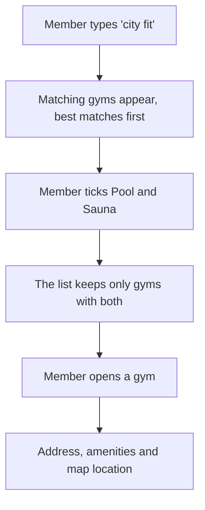

# Facility Search API — stakeholder overview

For product owners, operations and leadership. Technical readers can go to the [README](../README.md) (quick start and API), [`DESIGN.md`](DESIGN.md) (the reasoning behind each decision), [`ARCHITECTURE.md`](ARCHITECTURE.md) and [`TESTING.md`](TESTING.md). Technical words are explained in the [glossary](#glossary).

## In one paragraph

The Facility Search API is the search behind "find a gym": as a member types into an app, it returns the gyms whose names match, narrows them by amenities such as Pool or Sauna, and gives the full details of the gym the member picks. (The code and the data call gyms "facilities".) It is working, covered by 96 automated tests and packaged as a container ready to deploy. It was designed and measured for 100,000 gyms and checked at 1,000,000; the current data file holds 100 sample gyms in Sydney and Melbourne. One part is a stand-in: sign-in uses the mock provided with the [brief](CHALLENGE.md), which cannot prove who issued a sign-in token, so it must be replaced by a real identity provider before launch.

## What members get

1. **The member types "city fit".** Each typed word must match the start of a word in the gym's name, in any order, ignoring capitals and accents. "city fit" finds "City Fitness Central"; "ness" finds nothing, because it is the middle of a word.
2. **Matching gyms appear, best matches first.** Gyms whose name starts with what the member typed come first, then every other match; each group is alphabetical. Results come in pages of 20 by default (up to 100), with each gym's name and address.
3. **The member ticks Pool and Sauna.** The list keeps only gyms that have every ticked amenity. A member can tick up to 20.
4. **The member opens a gym** and sees its address, its full list of amenities and its map coordinates. In the sample data, City Fitness Central is at 123 Market St, Sydney, with Pool, Sauna, 24/7 Access and Yoga Classes.

Every one of these steps is a request from the member's app to this service, and every request must carry a valid sign-in token.

## What's built and what's deferred

| Capability                   | Status   | Note                                                                                                                                                                                                     |
| ---------------------------- | -------- | -------------------------------------------------------------------------------------------------------------------------------------------------------------------------------------------------------- |
| Search as you type           | Built    | Matches the start of any word in a gym's name. Fast enough to answer as the member types (see [Speed and scale](#speed-and-scale)).                                                                      |
| Amenity filters              | Built    | A gym must have every ticked amenity ("has all"). See [Decisions](#decisions-the-business-needs-to-make).                                                                                                |
| Gym details                  | Built    | Name, address, amenities and map coordinates.                                                                                                                                                            |
| Sign-in check                | Built    | Every search and details request needs a valid, unexpired token. Uses the stand-in sign-in for now.                                                                                                      |
| Abuse limits                 | Built    | Caps on how fast one internet address can call the service. See [Security and privacy](#security-and-privacy).                                                                                           |
| Health check                 | Built    | Lets a load balancer confirm each copy of the service is up.                                                                                                                                             |
| API documentation page       | Built    | An interactive page for app developers, generated from the code so it stays in step with it.                                                                                                             |
| Automatic quality checks     | Built    | Every code change is checked and tested automatically (CI).                                                                                                                                              |
| Container packaging          | Built    | One image runs the same way on any server.                                                                                                                                                               |
| Real sign-in provider        | Deferred | Required before launch. Only the sign-in check changes, and the stand-in login is removed.                                                                                                               |
| Live data updates            | Deferred | Gym data is read once at startup; a change needs a restart.                                                                                                                                              |
| Caching                      | Deferred | A short-lived cache of checked sign-in tokens would remove the sign-in delay from repeat requests. Caching search results isn't worth it: search is already faster than a cache lookup over the network. |
| Shared limits across servers | Deferred | Each copy of the service counts requests on its own.                                                                                                                                                     |
| Metrics and tracing          | Deferred | Today there are logs only.                                                                                                                                                                               |
| Typo tolerance               | Deferred | A misspelt word usually finds nothing; there are no synonyms either.                                                                                                                                     |

The brief, the original scope and what was left out on purpose are in [`DESIGN.md` §1](DESIGN.md#1-goals-and-scope).

## Speed and scale

Search is not what a member waits for. At 100,000 gyms a typical search takes from a few thousandths of a millisecond (a short word) to about a quarter of a millisecond (with amenity filters). Even the slowest of 7,000 timed searches took under half a millisecond. Checking every gym one by one, the simplest alternative, would take about 4–10 ms per search.

| Measure                             | 100,000 gyms       | 1,000,000 gyms                |
| ----------------------------------- | ------------------ | ----------------------------- |
| Search time, worst 1%               | under 0.4 ms       | around 3 ms                   |
| Slowest single search seen          | 0.42 ms            | 8–26 ms, varying between runs |
| Checking every gym instead, typical | about 4–10 ms      | 34–98 ms                      |
| Building the search data at startup | under 1 s (826 ms) | about 10 s                    |
| Memory for the search data          | about 21 MB        | about 200 MB (199 MB)         |

These figures time the search code alone, run by a benchmark program rather than through the running service, using generated gym data on one developer laptop (Intel Core i7-9750H, 16 GB RAM, Node 24.22). They don't include the network or the sign-in check. The full results, and the three earlier designs that fell short at 1,000,000 gyms, are in the README's [Performance](../README.md#performance) section.

**What a member actually waits for** is the network trip between their phone and the server, which this service doesn't control, and the sign-in check. The stand-in sign-in check waits 100–500 ms on every search and details request, on purpose, to behave like a remote sign-in service. Search adds well under a millisecond on top. Making search faster would go unnoticed; the [roadmap](#roadmap) targets the sign-in delay instead.

## Security and privacy

- **Sign-in is required** for search and gym details. A missing, malformed, invalid or expired token is refused. Only the health check, the documentation page and the stand-in login are open.
- **Abuse limits:** by default one internet address can make 100 requests a minute, and 10 login attempts a minute. Both are counted per address. Extra requests are refused with an answer that says when to try again. The limit is checked before the sign-in check, so a flood of requests never reaches the sign-in check. The general limit is a setting; the login limit is fixed in the code.
- **Inputs are checked** before they are used: search text is at most 100 characters, a request lists at most 20 amenities, and request bodies are limited to 10 KB.
- **No member records are stored.** The service has no database. It checks the member's token on each request and keeps nothing afterwards. Apart from the gym data, the only thing it holds between requests is a count of recent requests per internet address, in memory, for the abuse limits.
- **Errors never reveal internals.** An unexpected failure returns a generic message and a reference ID; the details go to the logs only. Responses contain only the fields the API declares, so a new internal field can't leak by accident.
- **Logs never contain passwords or tokens.** Request bodies are never logged, and the sign-in header is masked. Logs do record each request's web address (URL), including any search text, and the caller's internet address.
- **Encryption in transit** (HTTPS) is expected to end at the load balancer in front of the service; the service itself speaks plain HTTP.
- **The stand-in sign-in is not secure.** It accepts any email and password (one test password is refused), and its tokens carry no signature it can check, so anyone who knows the format can make one. The service closes the gaps it can (it rejects expired tokens and tokens without a valid member), but a real identity provider is required before launch.

## Reliability and operations

- **Health check.** Load balancers can poll it to confirm a copy of the service is up. It reports the number of gyms loaded and is never rate limited or logged. It doesn't check other systems, such as the sign-in service.
- **Clean restarts.** When asked to stop, the service stops taking new requests and finishes the ones in progress, for up to 10 seconds. In a container test, stopping took about 0.2 s.
- **Fails safe at startup.** An invalid setting or a bad gym record stops the service from starting, with a message naming the setting or the record's position. It never runs with invalid settings or serves part of the data.
- **Crashes are visible.** An unexpected error that nothing else catches is logged and the service exits, so the container platform can restart it from a clean state.
- **Every request is traceable.** Each response carries a request ID, which also appears in the logs and in the service's error responses. Support can match a member's error to the exact log lines. Health checks are the one exception: they aren't logged.
- **Every change is checked automatically.** On every change pushed to the code repository, CI runs the style and quality checks, the 96 tests, the production build and the container build. The tests run 99.66% of the lines of code they measure. How the tests work, and how they were themselves checked, is in [`TESTING.md`](TESTING.md).

## Running cost and footprint

- **One container per instance.** Besides the base system that runs it, the image holds only the compiled service, the libraries it needs to run and the gym data file. It runs without administrator rights. No database or other service is needed today.
- **Memory.** The search data takes about 21 MB at 100,000 gyms and about 200 MB at 1,000,000. The benchmark measures the search data only; the whole process uses more, which hasn't been measured.
- **Scaling out.** Each instance holds the whole gym list and answers on its own, so capacity grows by adding instances behind a load balancer. The load balancer's addresses must be listed in the service's settings, so that limits apply to each member's real address.
- **Shared limits.** Limits are counted per instance. Sharing them across instances needs a small shared store (Redis), which isn't built.
- No hosting cost estimate has been made.

## Risks and mitigations

| Risk                                                                   | Impact                                                                                                      | Mitigation                                                                                                                                                                                                  |
| ---------------------------------------------------------------------- | ----------------------------------------------------------------------------------------------------------- | ----------------------------------------------------------------------------------------------------------------------------------------------------------------------------------------------------------- |
| Stand-in sign-in                                                       | Anyone who knows the token format could use the service. It must not go live like this.                     | Replace it with a real identity provider before launch. Only the sign-in check changes, and the stand-in login is removed.                                                                                  |
| Data changes need a restart                                            | New or changed gyms don't appear until every instance restarts.                                             | Restarts are clean, and building the search data takes under a second at 100,000 gyms. Next: refresh the data in the background, without a restart.                                                         |
| Staff in one office share an internet address, so they share one limit | A busy office could see requests refused: more than 100 a minute in total, or more than 10 logins a minute. | Raise the general limit (a setting). Apps should search after a short pause in typing, not on every keystroke. With a real identity provider, sign-in moves to the provider and this login limit goes away. |
| No typo tolerance or synonyms                                          | A misspelt or differently worded search usually finds nothing; "life" doesn't find "FitLife".               | Matching the start of each word covers search as you type. Typo tolerance and better ranking are on the roadmap.                                                                                            |
| Limits apply per instance                                              | With three instances, one address could make up to three times the limit.                                   | Share the counts through Redis (a small change, not built).                                                                                                                                                 |
| A single data file is the source of truth                              | No editing tool and no named owner; a bad record stops new instances from starting.                         | Every record is checked at startup, so bad data is refused rather than served. Roll data changes out gradually so running instances keep serving. Decide who owns the data (below).                         |

## Decisions the business needs to make

| Decision                                    | Options                                                                                                                                       | Recommendation                                                                                                                                                                                 |
| ------------------------------------------- | --------------------------------------------------------------------------------------------------------------------------------------------- | ---------------------------------------------------------------------------------------------------------------------------------------------------------------------------------------------- |
| Amenity filter: "has all" or "has any"      | "Has all" (built): each ticked amenity narrows the list. "Has any": each ticked amenity widens it.                                            | Keep "has all", which is how filter checkboxes usually behave. The brief's example ("Pool" or "Sauna") reads either way. If "has any" is wanted too, it needs its own option.                  |
| Rate limits for corporate offices           | Per internet address (built); per signed-in member; higher limits for known office addresses.                                                 | Keep the per-address limit, because it stops floods before the sign-in check. Raise it if office traffic needs it. Add a per-member limit later if one member's traffic needs capping.         |
| Identity provider                           | The system members already sign in with; a managed sign-in service.                                                                           | Use the one members already use, so one sign-in covers everything. It must issue signed tokens with published keys, which this service can then check.                                         |
| How often gym data changes, and who owns it | Restart to load a new file (today); refresh in the background without a restart (planned); a database that staff edit directly.               | Name an owner. If the list changes a few times a day or less, background refresh is enough. Frequent edits or a much larger list point to a database.                                          |
| Search quality expectations                 | Match the start of words (built); split joined words such as "FitLife"; tolerate typos and add synonyms; search by location ("gyms near me"). | Decide from real member behaviour: measure which searches find nothing (needs metrics), then fix the most common causes first. Location search can use the coordinates the data already holds. |

The reasoning behind the built choices is in [`DESIGN.md` §3.5](DESIGN.md#35-api-decisions).

## Roadmap

Sizes are rough estimates of relative effort, not commitments. **S:** a small, self-contained change. **M:** several parts change, or another team is involved. **L:** new infrastructure to build and run.

| When  | Item                               | Size | Why                                                                                                                                |
| ----- | ---------------------------------- | ---- | ---------------------------------------------------------------------------------------------------------------------------------- |
| Now   | Real identity provider             | M    | Required before launch: the stand-in can't prove who issued a token.                                                               |
| Now   | Confirm the amenity filter rule    | S    | Changing it after launch would change the results members see.                                                                     |
| Next  | Cache checked sign-in tokens       | S    | Removes the sign-in delay from repeat requests while a member types. A withdrawn token would keep working until its entry expires. |
| Next  | Refresh data without a restart     | M    | Gym changes appear without restarting every instance.                                                                              |
| Next  | Share rate limits across instances | S    | The same limit however many instances run.                                                                                         |
| Next  | Metrics and tracing                | M    | Response times and error rates over time, and slow requests followed across services. Today there are logs only.                   |
| Later | Database or search engine          | L    | Once gym data changes often or outgrows memory. Only the storage part changes, plus how apps page through results.                 |
| Later | Typo tolerance and relevance       | M–L  | Finds gyms despite misspellings and joined words, and orders results by more than "starts with what you typed".                    |
| Later | Location search                    | M    | "Gyms near me". The data already holds each gym's coordinates.                                                                     |

The technical version of this list is in the README's [Next steps](../README.md#next-steps) and [`DESIGN.md` §13](DESIGN.md#13-scaling-path-and-future-work).

## Glossary

| Term                | Meaning                                                                                                                                                 |
| ------------------- | ------------------------------------------------------------------------------------------------------------------------------------------------------- |
| API                 | Application programming interface: the set of web addresses an app calls to get data. Members never see it; their app does.                             |
| Cache               | A short-term store of answers already worked out, so repeat requests skip the work.                                                                     |
| CI                  | Continuous integration: checks that run automatically on every code change (here on GitHub Actions), so a broken change is caught early.                |
| Container, image    | An image is a packaged copy of the service with everything it needs to run, so it runs the same way on any server. A container is a running image.      |
| Health check        | An address a load balancer calls regularly to confirm an instance is up.                                                                                |
| HTTP, HTTPS         | The way apps and servers exchange requests on the web. HTTPS is the encrypted version, so no one in between can read or change the traffic.             |
| Identity provider   | The system that signs members in and issues sign-in tokens, which other services trust to say who a member is.                                          |
| Instance            | One running copy of the service. Several instances can run side by side to share the load.                                                              |
| Load balancer       | Spreads incoming requests across instances and stops sending requests to one that fails its health check.                                               |
| Metrics and tracing | Metrics are counts and timings over time, such as response times. Tracing follows one request through every service it touches.                         |
| Millisecond (ms)    | A thousandth of a second.                                                                                                                               |
| p99, "worst 1%"     | The time within which 99 of every 100 searches finish; only 1 in 100 is slower. p50 is the typical (middle) time.                                       |
| Rate limit          | A cap on how many requests one caller can make in a period. Extra requests are refused, with a time to retry, until the period resets.                  |
| Redis               | A widely used shared data store. Here it would hold rate-limit counts shared by all instances.                                                          |
| Sign-in token       | A code the member's app receives at sign-in and sends with every request to prove the member is signed in. The stand-in's tokens expire after one hour. |
