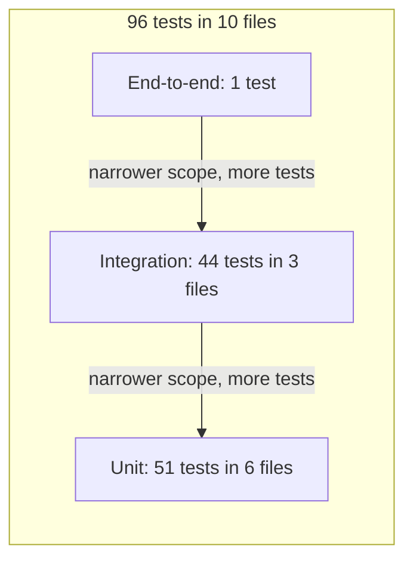

# Testing guide

This guide explains how the Facility Search API is tested, why the tests can be trusted, and how to run and extend them. It is for developers changing the code and for reviewers judging it.

Read next: [`ARCHITECTURE.md`](ARCHITECTURE.md) for how the parts fit together, and the README's [Testing](../README.md#testing) section for the short version. The original test plan is in [`DESIGN.md` §10](DESIGN.md#10-testing).

## Principles

- **Test behaviour through public interfaces.** Unit tests call what a module exports, such as `tokenize`, `FacilityIndex.search` and `loadConfig`. HTTP tests build the whole app with `buildApp` and send requests with Fastify's `app.inject()`. A request then goes through the same routing, hooks, validation, serialisation and error handler as a real one, without opening a socket.
- **Fast fakes instead of the mock's delays.** The provided mock auth waits 0.5–2 s per login and 0.1–0.5 s per token check. HTTP tests use `fakeLogin` and `fakeVerifier`, which answer at once.
- **One end-to-end test with the real mock.** Exactly one test runs the real mock `login` and the real `MockTokenVerifier` together. Two unit tests also wrap the real `verifyToken`, to show that the gaps it leaves are closed.
- **Deterministic.** Generated data comes from a seeded generator, no test uses the network, and the token-verifier tests that use a fake decoder inject a fixed clock. The two tests that use the real `verifyToken` keep the real clock, which cannot change their result: one token has no user, and the other expired a second before the test runs. The only real waits are the mock's random delays, in the end-to-end test and the two unit tests that use the real `verifyToken`. They change how long a test takes, never its result.
- **Every file stands alone.** Each test file builds its own apps and data and shares no state with other files, so any file can run on its own.

## Test pyramid



- **End-to-end:** the real mock login and token check through the API: log in, then search with the returned token. The file lives in `test/integration/` but is counted as its own level.
- **Integration:** the whole app through `app.inject()`, with the real data file (100 facilities) and fake auth. Covers status codes, Problem Details, authentication, rate limits, CORS, request IDs, security headers, response schemas and the OpenAPI document.
- **Unit:** single modules called directly, with no HTTP: the tokenizer, the search index, the data loader, the repository, configuration and the token verifier.

## Running the tests

Use Node 24 (`nvm use` reads `.nvmrc`). Vitest 5 does not support Node 25.

| Goal                     | Command                                                                                  |
| ------------------------ | ---------------------------------------------------------------------------------------- |
| All tests                | `npm test`                                                                               |
| One level                | `npx vitest run test/unit`                                                               |
| One file                 | `npx vitest run test/unit/config.test.ts`                                                |
| One test by name         | `npx vitest run -t "rejects duplicate ids"`                                              |
| Watch mode               | `npm run test:watch`                                                                     |
| Coverage                 | `npm run test:coverage`                                                                  |
| The full CI gate locally | `npm run typecheck && npm run lint && npm run format:check && npm test && npm run build` |

CI ([`.github/workflows/ci.yml`](../.github/workflows/ci.yml)) runs on every push and pull request: `npm ci`, lint, format check, typecheck, tests, build, then `docker build .`. Test files are linted and type-checked like the source. The benchmark is not part of CI (see [Performance testing](#performance-testing)).

## Test inventory

| File                                                                                | Level       | What it protects                                                                                                                                                                                                                                                                                                                                       | Tests |
| ----------------------------------------------------------------------------------- | ----------- | ------------------------------------------------------------------------------------------------------------------------------------------------------------------------------------------------------------------------------------------------------------------------------------------------------------------------------------------------------ | ----- |
| [`test/unit/tokenize.test.ts`](../test/unit/tokenize.test.ts)                       | Unit        | Lowercasing, accent stripping, splitting on spaces, punctuation and symbols, no split at capitals inside a word, empty and punctuation-only input                                                                                                                                                                                                      | 5     |
| [`test/unit/facility-index.test.ts`](../test/unit/facility-index.test.ts)           | Unit        | Word-start matching and case; ranking (names starting with the query first, then alphabetical, ties by id); 1–3 letter prefix lists; every word required, in any order; amenity filter; listing and paging across ranked groups; summary fields; lookups; agreement with a brute-force reference                                                       | 23    |
| [`test/unit/load-facilities.test.ts`](../test/unit/load-facilities.test.ts)         | Unit        | Loading the provided file (`facilities` renamed to `amenities`); missing file; invalid JSON; data that is not an array; invalid records named by index and field; URL-safe ids; duplicate ids                                                                                                                                                          | 7     |
| [`test/unit/facility-repository.test.ts`](../test/unit/facility-repository.test.ts) | Unit        | `InMemoryFacilityRepository` searches, finds and counts through the index                                                                                                                                                                                                                                                                              | 3     |
| [`test/unit/config.test.ts`](../test/unit/config.test.ts)                           | Unit        | Defaults; conversion and list parsing; blank values treated as unset; invalid values, including `TRUST_PROXY` entries, rejected with the variable's name                                                                                                                                                                                               | 4     |
| [`test/unit/token-verifier.test.ts`](../test/unit/token-verifier.test.ts)           | Unit        | Valid tokens; expired, expiring-now and no-expiry tokens; empty payloads; unknown membership types; decoding failures as `InvalidTokenError`; both mock gaps closed with the real `verifyToken`                                                                                                                                                        | 9     |
| [`test/integration/platform.test.ts`](../test/integration/platform.test.ts)         | Integration | `/health` without a token and never rate limited; OpenAPI 3.1 with the Bearer scheme; Problem Details for unknown routes, malformed URLs and unexpected failures; unknown routes rate limited; request IDs; security headers; CORS                                                                                                                     | 13    |
| [`test/integration/auth.test.ts`](../test/integration/auth.test.ts)                 | Integration | Login success; email and password validation; 401 for rejected credentials; a generic 500 for unexpected failures; the 10-per-minute login limit; the OpenAPI entry with Problem Details errors                                                                                                                                                        | 8     |
| [`test/integration/facilities.test.ts`](../test/integration/facilities.test.ts)     | Integration | 401s with `WWW-Authenticate`; a verifier outage as 500; the token checked before input; search fields, paging and the amenity filter; 400s for bad `limit`/`offset`, an empty `q` and too many amenities; details and 404; over-long and malformed ids; the OpenAPI entries; rate limit before auth; trusted-proxy spoofing; response-schema filtering | 23    |
| [`test/integration/end-to-end.test.ts`](../test/integration/end-to-end.test.ts)     | End-to-end  | The real mock `login` and `MockTokenVerifier` through the API: log in, then search `q=harbour` and get `facility-003`. Takes up to about 2.5 s because of the mock's delays                                                                                                                                                                            | 1     |

## Test doubles and helpers

| Helper                           | File                                      | What it does                                                                                                                                 | Use it when                                                                                                          |
| -------------------------------- | ----------------------------------------- | -------------------------------------------------------------------------------------------------------------------------------------------- | -------------------------------------------------------------------------------------------------------------------- |
| `facility(id, name, amenities?)` | [`test/helpers.ts`](../test/helpers.ts)   | Builds a `Facility` with the address `<id> Test St` (for example `f2 Test St`) and a fixed Sydney location                                   | A unit test of the index or repository needs small, readable data                                                    |
| `TEST_USER`                      | `test/helpers.ts`                         | The user that `fakeVerifier` and `fakeLogin` return: `user-123`, a premium member                                                            | You assert on the signed-in user or put a user into a token                                                          |
| `VALID_TOKEN`                    | `test/helpers.ts`                         | The only token `fakeVerifier` accepts, and the token `fakeLogin` returns                                                                     | You need a token that passes authentication                                                                          |
| `AUTH_HEADER`                    | `test/helpers.ts`                         | `{ authorization: 'Bearer valid-test-token' }`, ready to pass as `headers`                                                                   | An `inject()` call to a facility route should get past authentication                                                |
| `mockToken(payload)`             | `test/helpers.ts`                         | Builds a token in the mock's format: base64 header, base64 JSON payload, fake signature                                                      | A token-verifier test needs a specific payload, such as an expired token or one with no user                         |
| `fakeVerifier`                   | `test/helpers.ts`                         | A `TokenVerifier` that accepts only `VALID_TOKEN`, instantly; any other token rejects with `InvalidTokenError`                               | Default in `buildTestApp()`. To simulate an outage, pass your own `{ verify }` that rejects with an ordinary `Error` |
| `fakeLogin`                      | `test/helpers.ts`                         | Like the mock login, without the delay: the password `error` fails; anything else returns `VALID_TOKEN` and `TEST_USER` with the given email | Default in `buildTestApp()`. Pass your own function to simulate other failures                                       |
| `testConfig(overrides?)`         | [`test/test-app.ts`](../test/test-app.ts) | A complete `Config`: environment `test`, log level `silent`, port 0, 1,000 requests per minute, no CORS origins, no trusted proxies          | A test needs one setting changed, such as `testConfig({ rateLimit: { max: 2, windowMs: 60_000 } })`                  |
| `buildTestApp(overrides?)`       | `test/test-app.ts`                        | The real app with the real data file, `testConfig()`, `fakeVerifier` and `fakeLogin`; any dependency can be replaced                         | Every HTTP-level test. Call `app.inject()`, then `app.close()`                                                       |

`test/test-app.ts` also exports `type TestApp`, the type `buildTestApp()` resolves to, for variables that hold an app.

Some doubles are local to one file:

- `token-verifier.test.ts` passes `MockTokenVerifier` a decoder that behaves like the mock's `verifyToken` without its delay, and a clock fixed at one instant. Its constructor accepts both for that reason.
- `facilities.test.ts` passes `buildTestApp()` an inline repository object that returns an extra field (see [Response-schema leak test](#response-schema-leak-test)).
- `platform.test.ts` replaces `repository.count` to make `/health` fail in controlled ways.

## Techniques worth knowing

### Brute-force reference test

The index is optimised: precomputed prefix lists, list merges, intersections in reused buffers and ranking by binary search. Each of those is a place for an off-by-one or a duplicate to hide, and example-based tests only cover the combinations someone thought of. The last test in `facility-index.test.ts`, "returns the same page and total for 500 random searches", checks the index against code that is slow but obviously right.

1. It generates 300 facilities from a seeded Park–Miller generator (seed 42). Names are built from a few syllables, so they share prefixes and repeat words, and they include accents (`Café`), numbers and `&` between words. Amenities include `Olympic Pool`, to catch partial amenity matches.
2. `reference()` applies the search rules directly to every facility: tokenize the query, require every term to start some word of the name, require every amenity (trimmed, ignoring case), sort names that start with the whole query first, then by name, then by id, and slice the page.
3. It runs 500 random searches: one to three terms of one to four characters (some are digits), no `q` about one time in ten, an amenity filter about three times in ten, `limit` 1–20 and `offset` 0–29. Each result must equal the reference's page and total. A failure message includes the search parameters, so the case can be replayed.

To explore more cases locally, change the seed and run the file; keep the committed seed fixed so the test stays reproducible. In the [proven guards](#proven-guards), this test caught both "merge keeps duplicate facilities" and "longer prefixes match only the first word".

### Hook-order guards

The order rate limit → token check → validation is deliberate (see [`DESIGN.md` §6](DESIGN.md#6-request-lifecycle)). The limiter runs first, so a flood never reaches the slow verifier. The token check runs before validation, so a caller without a token learns nothing about valid parameters. Two tests in `facilities.test.ts` pin that order:

- "checks the token before validating input" sends `limit=101` without a token and expects 401, not 400. It fails if the auth hook moves to `preHandler`, which runs after validation.
- "are rate limited before the token is checked" allows 2 requests per minute and sends three without a token. The third must be 429 with `Retry-After` and Problem Details. It fails if the auth hook moves to `onRequest`.

### Response-schema leak test

"drop fields they do not declare" builds the app with an inline repository whose facility carries an extra `internalScore` field. The search response must contain exactly `id`, `name` and `address` per item, and the detail response must not contain `internalScore`. This proves the 200 response schemas filter what reaches the client, so a future repository, such as a database with extra columns, cannot leak fields. Removing the detail route's 200 schema makes it fail.

### Trusted-proxy spoofing test

"rate limit by the client address a trusted proxy adds, ignoring spoofed entries" sets `trustProxy` to `10.0.0.0/8` and the limit to 2. Every request arrives from the load balancer at `10.0.0.5` with `X-Forwarded-For: <spoofed>, <real>`, and the spoofed entry changes on every request. The expected statuses are `401, 401, 429, 401`: the third request from the same real client is limited despite a new spoofed address, and a different real client is not. It fails if every proxy is trusted, because the client could then choose its own address. It also fails if the auth hook moves before the limiter.

### Router-error tests

Fastify's router rejects some requests before any hook runs, so the error handler, the rate limiter and the security headers never see them. The `frameworkErrors` option in `src/app.ts` turns them into Problem Details. Two tests pin this:

- "returns Problem Details for a malformed URL": `/health%zz` returns 400 `Malformed URL` as `application/problem+json`, with an `x-request-id` header.
- "returns 400 Problem Details for an id longer than the router allows": a 101-character id returns 400 `Path parameter too long`. The router's limit is 100 characters; shorter ids that break the id rule get the schema's 400 instead.

### Safe-integer tests

Query-string validation turns a value such as `limit=1e400` into `Infinity` and skips its minimum and maximum, so the handler also requires `limit` and `offset` to be safe integers. One `it.each` in `facilities.test.ts` runs four cases: `limit=1e400`, `offset=1e400`, `offset=-Infinity` and `offset=9007199254740993`. Each must return 400 with the detail `limit and offset must be integers in range`.

## Proven guards

A passing suite only matters if it fails when the code is wrong. To check that, each behaviour below was deliberately broken on a scratch copy of the final code and the suite was run again. All 32 behaviour-changing breaks made at least one test fail. The two performance-only changes keep every result the same, so no test should fail; the benchmark is what measures them.

| Deliberate break                                                 | File                           | Test(s) that failed                                                                                                                   |
| ---------------------------------------------------------------- | ------------------------------ | ------------------------------------------------------------------------------------------------------------------------------------- |
| auth hook moved from preValidation to onRequest                  | `src/routes/facilities.ts`     | are rate limited before the token is checked; rate limit by the client address a trusted proxy adds, ignoring spoofed entries         |
| auth hook moved from preValidation to preHandler                 | `src/routes/facilities.ts`     | checks the token before validating input                                                                                              |
| WWW-Authenticate header removed from 401s                        | `src/plugins/authenticate.ts`  | rejects a request with no Authorization header; rejects a non-Bearer scheme                                                           |
| verifier outages treated as invalid tokens (401)                 | `src/plugins/authenticate.ts`  | returns 500, not 401, when the verifier itself fails                                                                                  |
| safe-integer check on limit/offset removed                       | `src/routes/facilities.ts`     | rejects limit=1e400, which validation turns into an unsafe number; rejects offset=1e400, which validation turns into an unsafe number |
| 200 response schema removed from the detail route                | `src/routes/facilities.ts`     | drop fields they do not declare                                                                                                       |
| 401 documented as plain JSON instead of application/problem+json | `src/routes/facilities.ts`     | are documented in the OpenAPI document                                                                                                |
| limit made a required query parameter                            | `src/schemas/facilities.ts`    | are documented in the OpenAPI document                                                                                                |
| TRUST_PROXY list replaced by trusting every proxy                | `src/app.ts`                   | rate limit by the client address a trusted proxy adds, ignoring spoofed entries                                                       |
| frameworkErrors handler removed                                  | `src/app.ts`                   | returns 400 Problem Details for an id longer than the router allows; returns Problem Details for a malformed URL                      |
| incoming x-request-id accepted without validation                | `src/app.ts`                   | replaces a malformed x-request-id with a UUID                                                                                         |
| rate limiting removed from unknown routes                        | `src/plugins/error-handler.ts` | rate limits unknown routes                                                                                                            |
| error handler assumes every thrown value is an Error             | `src/plugins/error-handler.ts` | hides unexpected failures behind a generic 500                                                                                        |
| any status below 500 passed through to the client                | `src/plugins/error-handler.ts` | treats a non-4xx status on an error as unexpected                                                                                     |
| missing-field errors no longer point at the field                | `src/plugins/error-handler.ts` | rejects a missing password                                                                                                            |
| /health no longer exempt from rate limiting                      | `src/routes/health.ts`         | is not rate limited                                                                                                                   |
| login's own 10-per-minute limit removed                          | `src/routes/auth.ts`           | allows 10 attempts per minute from one client                                                                                         |
| every login failure mapped to 401                                | `src/routes/auth.ts`           | returns a generic 500 when login fails unexpectedly                                                                                   |
| email format check removed from login                            | `src/schemas/auth.ts`          | rejects an invalid email address; rejects an email with non-Latin-1 characters                                                        |
| token expiry check removed                                       | `src/auth/token-verifier.ts`   | rejects an expired token; rejects a token that expires exactly now                                                                    |
| user-shape check removed from token verification                 | `src/auth/token-verifier.ts`   | rejects an empty payload, which the mock resolves to undefined; rejects a user with an unknown membership type                        |
| blank environment values no longer treated as unset              | `src/config.ts`                | treats blank values as unset                                                                                                          |
| TRUST_PROXY entries no longer validated                          | `src/config.ts`                | rejects invalid values with the variable name                                                                                         |
| /0 ranges accepted in TRUST_PROXY                                | `src/config.ts`                | rejects invalid values with the variable name                                                                                         |
| data loader stops enforcing the URL-safe id rule                 | `src/data/load-facilities.ts`  | rejects ids that could not be used in a URL                                                                                           |
| duplicate facility ids accepted                                  | `src/data/load-facilities.ts`  | rejects duplicate ids                                                                                                                 |
| accent stripping removed from tokenize                           | `src/search/tokenize.ts`       | strips accents                                                                                                                        |
| paging off by one across ranked groups                           | `src/search/facility-index.ts` | returns the requested page and the total across all pages; pages across the ranked groups                                             |
| ranking groups swapped (prefix matches no longer first)          | `src/search/facility-index.ts` | matches the start of any word in the name; ignores case                                                                               |
| merge keeps duplicate facilities                                 | `src/search/facility-index.ts` | ranks names that start with the query first, then alphabetically; returns the same page and total for 500 random searches             |
| unknown short prefix returns every facility                      | `src/search/facility-index.ts` | handles 1–3 letter prefixes, which use precomputed lists; returns nothing for an unknown word or a punctuation-only query             |
| longer prefixes match only the first word                        | `src/search/facility-index.ts` | does not match the middle of a word; returns the same page and total for 500 random searches                                          |

| Performance-only change                                             | File                           | Result                                                                                                |
| ------------------------------------------------------------------- | ------------------------------ | ----------------------------------------------------------------------------------------------------- |
| every intersection writes into the same scratch buffer              | `src/search/facility-index.ts` | survives by design: results are unchanged; only speed or memory differs, which the benchmark measures |
| precomputed prefix lists disabled (all prefixes merged per request) | `src/search/facility-index.ts` | survives by design: results are unchanged; only speed or memory differs, which the benchmark measures |

## Coverage

`npm run test:coverage` measures `src/**/*.ts` with the V8 provider:

| Metric     | Covered             |
| ---------- | ------------------- |
| Lines      | 301 of 302 (99.66%) |
| Statements | 99.69%              |
| Branches   | 93.08%              |
| Functions  | 100%                |

The one uncovered line is `src/app.ts:53`, which logs an unexpected framework error (Fastify raises one only for async route constraints, which this app doesn't use).

- `src/server.ts` is excluded in `vitest.config.ts`. It only wires the real dependencies together, listens and handles signals, so it is smoke-tested instead (see [Manual and operational checks](#manual-and-operational-checks)).
- Coverage is reported, not enforced. `vitest.config.ts` sets no threshold, and CI runs `npm test`, not `npm run test:coverage`.
- The summary prints in the terminal; the full report is written to `coverage/` (open `coverage/index.html`), which git ignores.

## Performance testing

[`scripts/benchmark.ts`](../scripts/benchmark.ts) measures the search index in-process, without HTTP, against a full scan. The design is in [`DESIGN.md` §11](DESIGN.md#11-benchmark-npm-run-bench); the results are in the README's [Performance](../README.md#performance) section.

How it works:

1. **Data.** It generates N facilities (100,000 by default; pass another count as the first argument) with a seeded generator (mulberry32, seed 42), so every run searches the same data. Names combine a made-up brand of two or three syllables, a kind such as `Gym` and a place such as `Bondi`. Amenities are random picks from the names in `assets/facilities.json`.
2. **Build.** It times `new FacilityIndex(...)` and measures the memory the index adds: JS heap plus typed-array storage (`heapUsed + arrayBuffers`), each read after a garbage collection.
3. **Queries.** Seven query types: 1 letter, 2 letters, 3 letters, 4+ letters, multi-word, with amenities, and no match. Each type cycles through two to four fixed queries, with `limit` 20 and `offset` 0. Before each measurement it collects garbage, then runs 200 warm-up searches, then times 1,000 with `performance.now()`.
4. **Baseline.** The same queries go through a full scan that checks every facility, using names and amenity sets prepared once outside the timing, with no ranking or sorting. That is the cheapest alternative, so the comparison does not favour the index.
5. **Output.** A Markdown table with p50, p95, p99 and the slowest sample (max) for the index, and p50 and p95 for the scan.

How to run it:

| Facilities | Command                    | Takes           |
| ---------- | -------------------------- | --------------- |
| 100,000    | `npm run bench`            | under a minute  |
| 1,000,000  | `npm run bench -- 1000000` | several minutes |

`npm run bench` runs the script with `--expose-gc`. Run another way, the script skips the garbage collections without warning, and the memory figure is no longer reliable.

How to read the output:

- The first two lines give the facility count, the Node version, the index build time and the index memory.
- p50 is a typical search; p95 and p99 are the slow tail. Max is the slowest of the 1,000 timed searches; it shows garbage-collection pauses that the percentiles can hide.
- Compare the index columns with the full-scan columns on the same row to see the speed-up.
- Single samples, especially max, vary between runs. Compare runs only on the same machine and Node version.

It is not in CI because timings on shared runners are noisy. The index's correctness is covered by the unit tests, including the brute-force reference test.

## Manual and operational checks

`src/server.ts` is excluded from coverage, so these checks cover startup, shutdown and packaging. Run them from the repository root with Node 24, after `npm install`. Each block is one check.

**Production build, health check and clean shutdown** (port 3999):

```bash
npm run build
PORT=3999 node dist/src/server.js > server.log 2>&1 &
SERVER_PID=$!
for i in $(seq 1 30); do curl -sf http://127.0.0.1:3999/health && break; sleep 0.5; done; echo
kill -TERM $SERVER_PID
wait $SERVER_PID
echo "exit code $?"
tail -1 server.log
```

Expected: `{"status":"ok","facilityCount":100,"uptimeSeconds":1}` (the uptime may differ), then `exit code 0`, then a JSON log line with `"signal":"SIGTERM"` and `"msg":"Shutting down"`. Git ignores `server.log` (`*.log`).

**Bad configuration** (needs the build above):

```bash
PORT=abc node dist/src/server.js; echo "exit code $?"
```

Expected: the first line is `ConfigError: Invalid configuration: PORT must be integer`, then a stack trace, then `exit code 1`.

**Missing data file** (needs the build above):

```bash
DATA_FILE=missing.json node dist/src/server.js; echo "exit code $?"
```

Expected: the first line is `DataLoadError: Could not read facilities from missing.json`, then a stack trace with a `[cause]` (the underlying `ENOENT` error), then `exit code 1`.

**Docker image** (needs Docker running and port 3000 free):

```bash
docker build -t facility-search-api .
docker run -d --name facility-search-api -p 3000:3000 facility-search-api
for i in $(seq 1 30); do curl -sf http://127.0.0.1:3000/health && break; sleep 0.5; done; echo
docker exec facility-search-api whoami
docker stop facility-search-api
docker logs facility-search-api | tail -1
docker inspect -f '{{.State.ExitCode}}' facility-search-api
docker rm facility-search-api
```

Expected:

- `curl` prints the same health JSON.
- `whoami` prints `node`: the app does not run as root.
- `docker stop` returns quickly (about 0.2 s when verified). If it takes about 10 s, SIGTERM did not reach the app and Docker killed it.
- The last log line contains `"signal":"SIGTERM"` and `"msg":"Shutting down"`.
- The exit code is `0`.

## Known gaps

These were logged during the task reviews and left as they are.

| Gap                                                                                                                                                                                                                                                                                                                                                                       | What would close it                                                                                                                    |
| ------------------------------------------------------------------------------------------------------------------------------------------------------------------------------------------------------------------------------------------------------------------------------------------------------------------------------------------------------------------------- | -------------------------------------------------------------------------------------------------------------------------------------- |
| Not pinned by tests (behaviour verified by probes): `q` over 100 chars, `amenities` over 1,000 chars, `limit=0` / non-integer, unknown query parameters ignored, offset past the end over HTTP, the 64-char id limit (the 101-char case is router-rejected), `Bearer` alone / `Bearer a b`, 429 content type on platform routes, `x-request-id` on thrown-error responses | One `inject()` case each in `facilities.test.ts` or `platform.test.ts`; for the id limit, a 65-character id expecting the schema's 400 |
| The real mock's rejection paths ('Invalid credentials', 'Invalid token') are not exercised end to end over HTTP (unit tests use the real `verifyToken`)                                                                                                                                                                                                                   | Two more cases in `end-to-end.test.ts`: the password `error` and an undecodable token, each expecting 401                              |
| No load test of the HTTP layer (the benchmark measures the index in-process)                                                                                                                                                                                                                                                                                              | A load tool such as autocannon or k6 against `npm start`, run by hand like the benchmark                                               |
| No contract tests against a client                                                                                                                                                                                                                                                                                                                                        | Contract tests with the first real client, for example checking its requests against the OpenAPI document at `/docs/json`              |
| No browser test of Swagger UI (checked manually)                                                                                                                                                                                                                                                                                                                          | A browser smoke test that opens `/docs`, logs in and runs a search                                                                     |
| Test apps built inside a test are closed after the assertions rather than in `finally` (inject-only apps hold no sockets)                                                                                                                                                                                                                                                 | Close them in `try`/`finally`, or register the close with Vitest's `onTestFinished`                                                    |

## Writing a new test

- **Pick the level.** Test a module's logic in `test/unit/<module>.test.ts`, calling it directly. Test HTTP behaviour (status codes, headers, Problem Details, hooks) in `test/integration/` with `buildTestApp()` and `app.inject()`. Vitest picks up any `test/**/*.test.ts` file.
- **Replace one dependency at a time.** Pass only what the test is about, such as `buildTestApp({ tokenVerifier })` or `buildTestApp({ config: testConfig({ trustProxy: ['10.0.0.0/8'] }) })`; everything else stays real or fast.
- **Use the helpers.** `facility()` for index data, `AUTH_HEADER` for authenticated requests, `mockToken()` for token payloads.
- **Close every app you build.** Use `afterAll` for an app shared by a file and `afterEach` for one built per test; close apps built inside a test before it ends.
- **Seed any randomness** and keep the seed in the file, as the brute-force reference test does.
- **No real network.** Use `app.inject()`; never call `listen()` in a test.
- **Keep tests independent of order.** A shared app is fine for read-only requests. A test that uses up a rate limit builds its own app with a low limit, as the rate-limit tests do.
- **Keep the real mock out of new tests.** It adds up to 2.5 s per test. If a test must use it, give it a timeout, as the end-to-end test does with `{ timeout: 10_000 }`.
- **Name the behaviour.** Test names such as "rejects duplicate ids" are what `-t` filters on and what the proven-guards table lists.
- **Update the counts** when you add or remove tests: the pyramid and the inventory here, and the total in [`STAKEHOLDERS.md`](STAKEHOLDERS.md).
